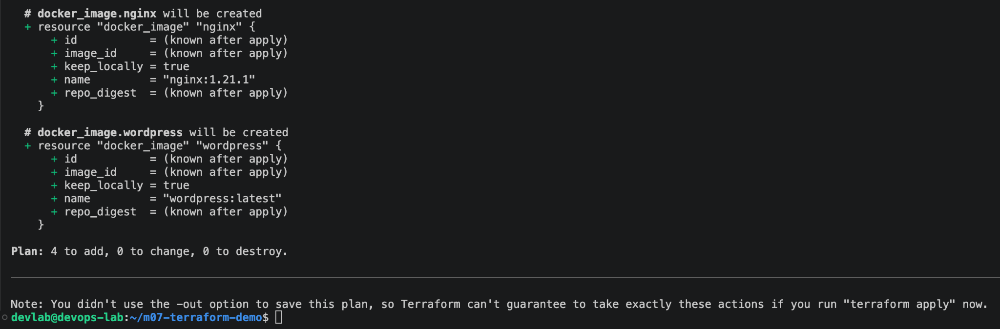
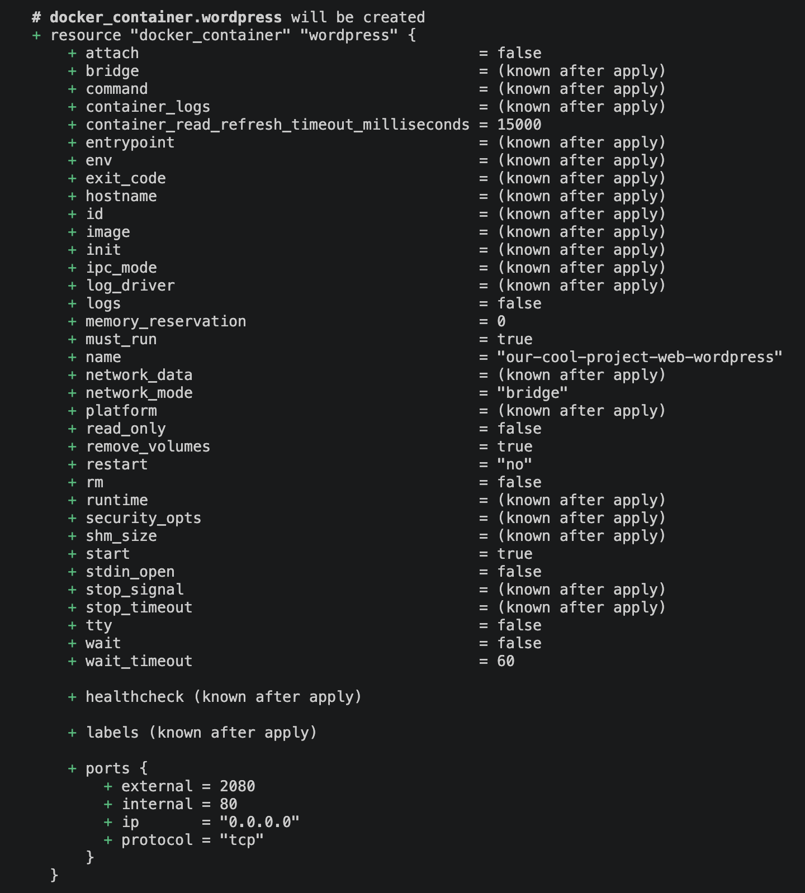
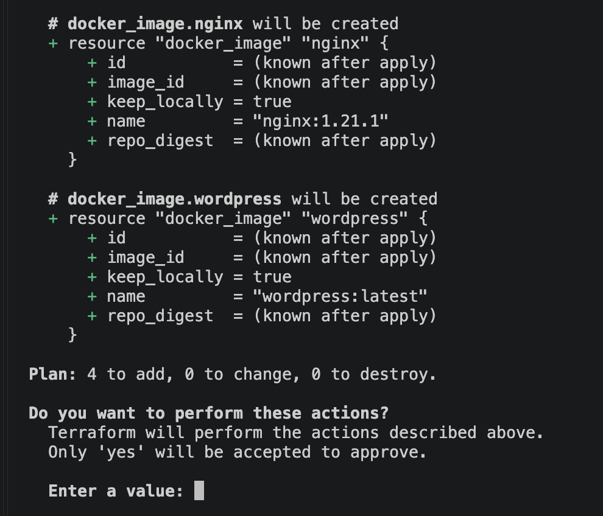
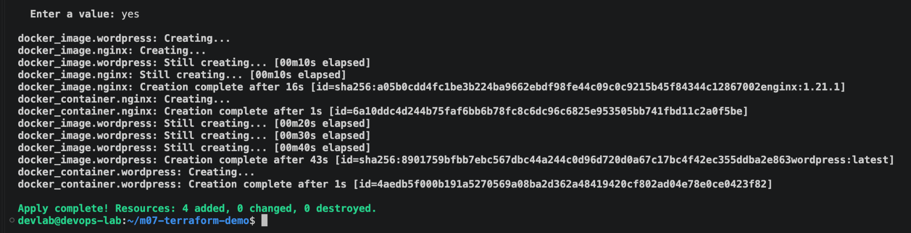
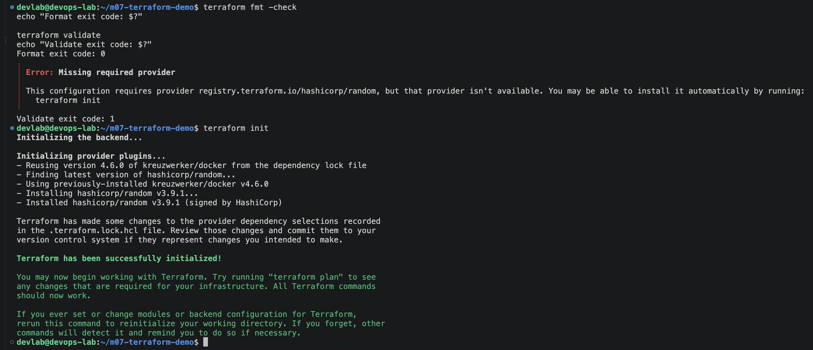
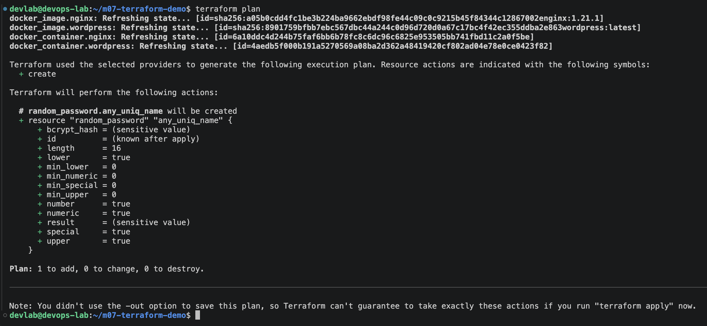
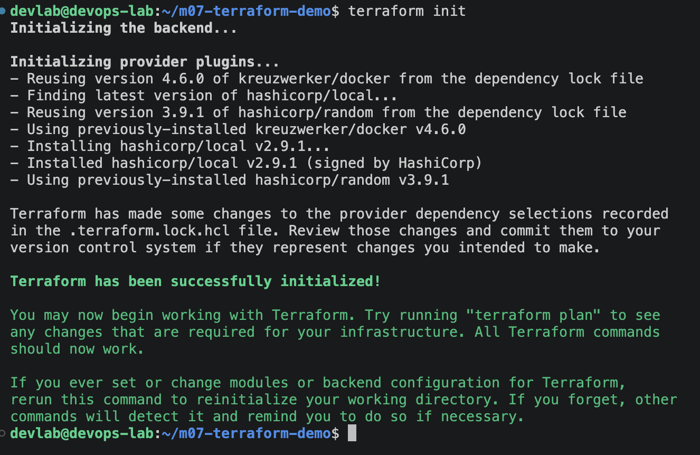
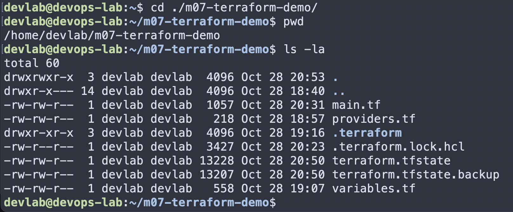
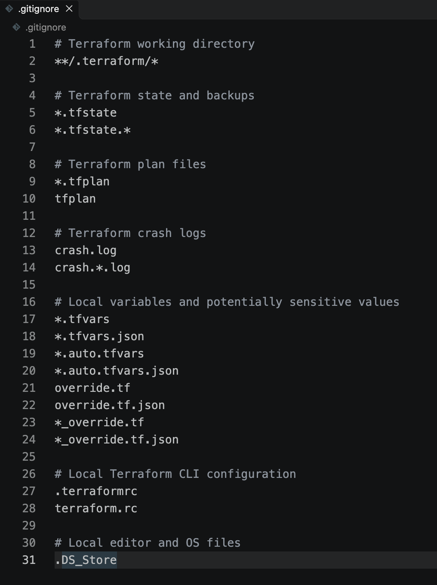

# Домашнее задание 7.2 — Terraform

## Содержание

1. [Задание](#1-задание)
2. [Подготовка окружения](#2-подготовка-окружения)
3. [Конфигурация Terraform](#3-конфигурация-terraform)
4. [Создание и проверка контейнеров](#4-создание-и-проверка-контейнеров)
5. [Дополнительные ресурсы и Terraform State](#5-дополнительные-ресурсы-и-terraform-state)
6. [Проверка configuration drift](#6-проверка-configuration-drift)
7. [Результат](#7-результат)

## 1. Задание

Нужно установить Terraform и повторить демонстрацию из лекции. Работа выполнена на виртуальной машине с Ubuntu Server и Docker. Конфигурация находится в файлах `providers.tf`, `variables.tf` и `main.tf` рядом с отчётом.

## 2. Подготовка окружения

Использована Ubuntu Server 24.04.4 LTS в Parallels Desktop. Подключение к виртуальной машине выполнено через VS Code Remote-SSH.

Установлен Terraform 1.17.0. Docker Engine был настроен заранее и доступен обычному пользователю. Для контейнеров использован провайдер `kreuzwerker/docker` версии 4.6.0.

Рабочий каталог инициализирован, конфигурация отформатирована и проверена:

```bash
terraform init
terraform fmt
terraform validate
```

Инициализация прошла успешно, проверка конфигурации ошибок не обнаружила.


## 3. Конфигурация Terraform

В `variables.tf` заданы параметры двух контейнеров: Nginx и WordPress. В `main.tf` описано создание Docker-образов и контейнеров.

Использованные образы:

- `nginx:1.21.1`;
- `wordpress:latest`.

Оба порта опубликованы на `127.0.0.1` виртуальной машины: Nginx — `1080`, WordPress — `2080`. Так они не открыты напрямую для всей сети.

Сначала выполнена команда:

```bash
terraform plan
```

Terraform сформировал план создания ресурсов. После проверки плана выполнен `terraform apply` с подтверждением.







После уточнения адреса публикации портов проверена привязка к `127.0.0.1`.





## 4. Создание и проверка контейнеров

После применения конфигурации состояние контейнеров проверено командой:

```bash
docker ps
```

Оба контейнера успешно запущены. Проверка HTTP показала: Nginx — `200 OK`, WordPress — перенаправление на первоначальную страницу настройки (`302`). База данных WordPress не настраивалась, поскольку для демонстрации запуска контейнера она не требовалась.


Для просмотра страниц в браузере Mac настроены SSH-туннели. Страница Nginx открылась, WordPress показал мастер начальной настройки.


## 5. Дополнительные ресурсы и Terraform State

Через `terraform console` просмотрены значения `var.containers` и параметры отдельных контейнеров.


Добавлен ресурс `random_password.any_uniq_name` длиной 16 символов. Для него подключён провайдер `hashicorp/random`. Затем выполнены `terraform init`, `terraform plan` и `terraform apply`.






Добавлен ресурс `local_file.xxx`, записывающий демонстрационную строку в `/tmp/xxx.txt`. Права файла установлены `0600`. Подключён провайдер `hashicorp/local`, после чего применена конфигурация.



После первоначального плана права нового файла изменены с `0777` на `0600`.


После создания файла командой `stat` проверены метаданные: владелец `devlab`, права `600`, размер 33 байта. Значение пароля не выводилось.


Команда `terraform state list` показала шесть ресурсов: два образа, два контейнера, `random_password` и `local_file`.


## 6. Проверка configuration drift

Проверена реакция Terraform на ручное изменение инфраструктуры. Исходное имя контейнера Nginx — `our-cool-project-reverse-proxy-nginx`. Затем контейнер переименован напрямую через Docker:

```bash
docker rename our-cool-project-reverse-proxy-nginx nginx-manually-renamed
```

При этом контейнер остался в состоянии `running`.


Следующий `terraform plan` обнаружил разницу с конфигурацией. Для возврата исходного имени Terraform предложил **заменить** контейнер, а не переименовать его на месте:

```text
Plan: 1 to add, 0 to change, 1 to destroy.
```


После `terraform apply` старый контейнер удалён и создан новый. Проверка показала: исходное имя `our-cool-project-reverse-proxy-nginx` восстановлено, состояние — `running`, HTTP-ответ Nginx — `200`.


Финальная команда `terraform plan` показала:

```text
No changes. Your infrastructure matches the configuration.
```


## 7. Результат

Terraform установлен, демонстрация из лекции повторена. Созданы и проверены контейнеры Nginx и WordPress. Выполнены упражнения с `terraform console`, `random_password`, `local_file` и Terraform State. Проверено обнаружение ручных изменений и восстановление конфигурации через Terraform.

Для подготовки к отправке проверен состав файлов и создан `.gitignore`. Файлы `terraform.tfstate`, `terraform.tfstate.backup` и каталог `.terraform/` не предназначены для загрузки в репозиторий.




