# DevOps • Автоматизация CI/CD
---
# Домашнее задание «Terraform»
__ШТЕНГЕЛОВ ИГОРЬ__

## Оглавление

1. [Подготовка окружения](#1-подготовка-окружения)
2. [Конфигурация и запуск контейнеров](#2-конфигурация-и-запуск-контейнеров)
3. [Проверка работы контейнеров](#3-проверка-работы-контейнеров)
4. [Terraform Console и дополнительные ресурсы](#4-terraform-console-и-дополнительные-ресурсы)
5. [Проверка изменений вне Terraform](#5-проверка-изменений-вне-terraform)
6. [Итог](#6-итог)

## 1. Подготовка окружения

Задание выполнено в Ubuntu Server 24.04.4 LTS на виртуальной машине Parallels. Для работы использованы Terraform 1.17.0 и Docker Engine. Подключение к Ubuntu выполнялось через VS Code Remote-SSH.

В рабочем каталоге подготовлены `providers.tf`, `variables.tf` и `main.tf`. Подключён Docker-провайдер `kreuzwerker/docker` версии `4.6.0`.

Выполнена инициализация и проверка конфигурации:

```bash
terraform init
terraform fmt
terraform validate
```

Инициализация прошла успешно, ошибок при проверке конфигурации нет.

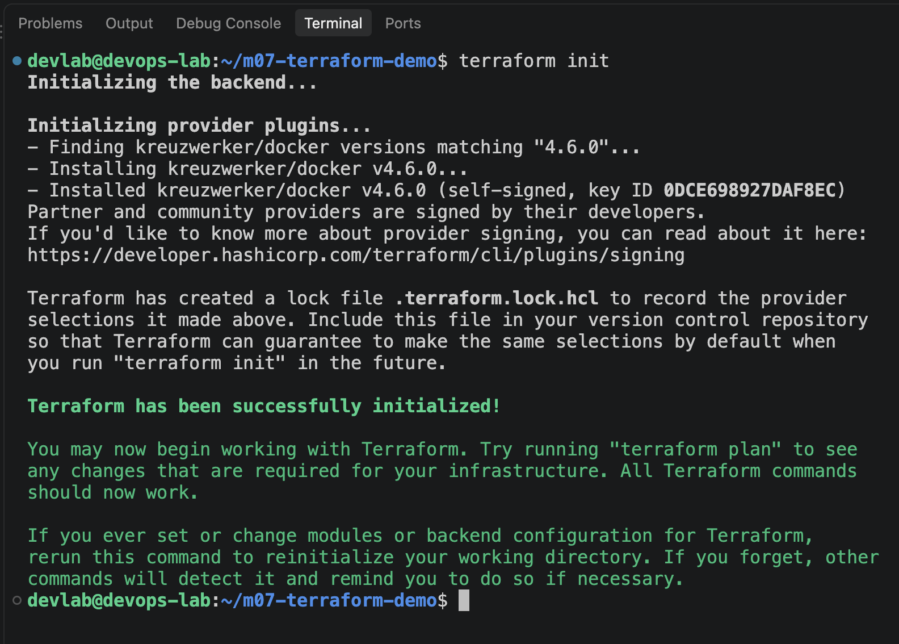

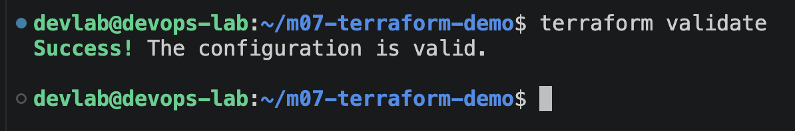

## 2. Конфигурация и запуск контейнеров

В конфигурации описаны два Docker-образа и два контейнера:

- Nginx — образ `nginx:1.21.1`, порт `1080`;
- WordPress — образ `wordpress:latest`, порт `2080`.

Порты привязаны к `127.0.0.1` Ubuntu, чтобы не публиковать сервисы непосредственно во внешнюю сеть.

После подготовки конфигурации выполнены `terraform plan` и `terraform apply`. Перед применением проверен итоговый план создания четырёх ресурсов.

Итоговый план подтвердил создание четырёх ресурсов:

Для Nginx проверена привязка порта `1080` к `127.0.0.1`:

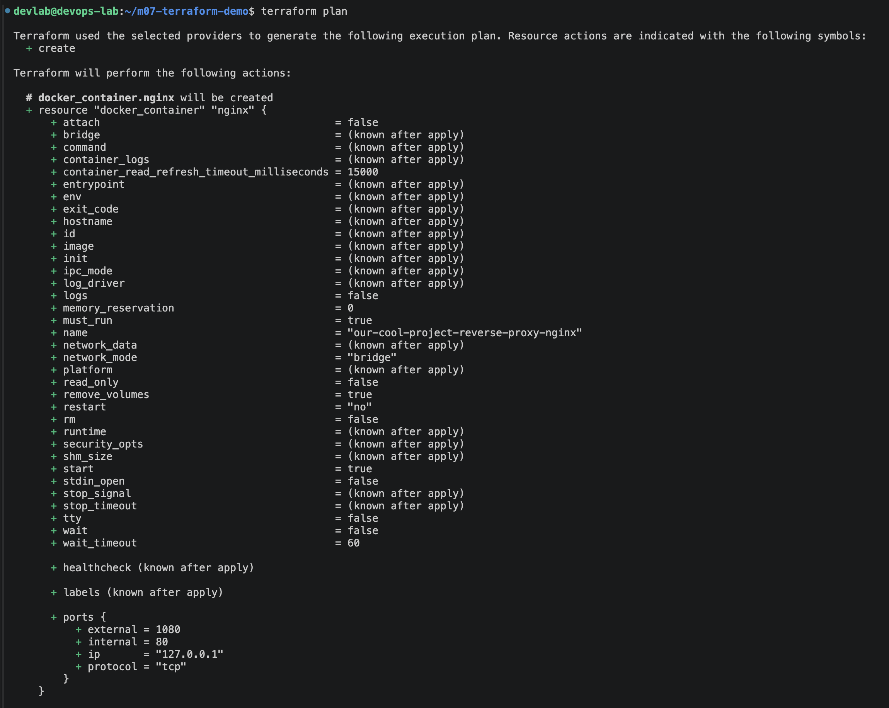

Для WordPress проверена привязка порта `2080` к `127.0.0.1`:

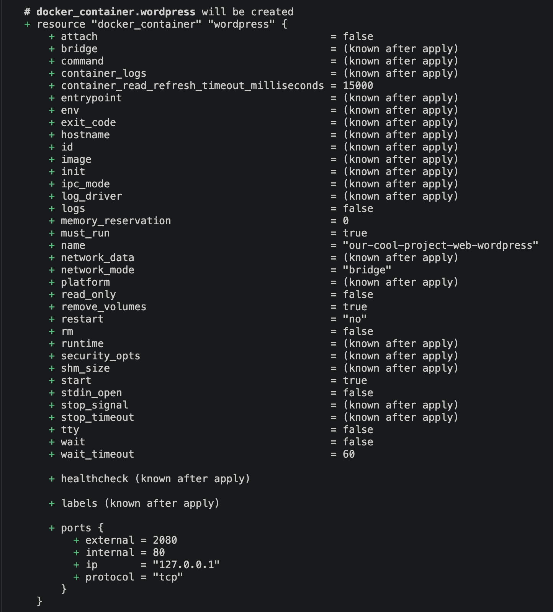

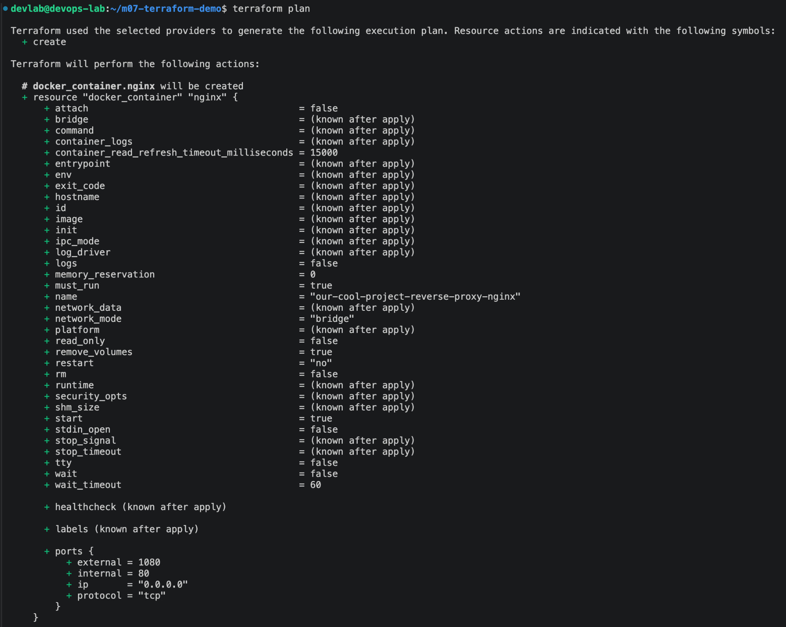

После подтверждения `terraform apply` создано четыре ресурса. Выполнение завершилось сообщением `Apply complete! Resources: 4 added, 0 changed, 0 destroyed`.

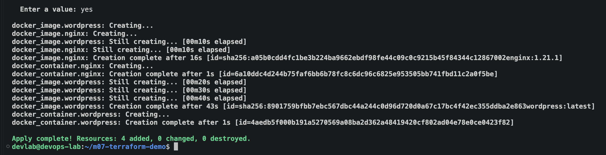

## 3. Проверка работы контейнеров

Командой `docker ps` проверено, что оба контейнера запущены. HTTP-проверки показали ответ `200` от Nginx и перенаправление `302` на первоначальную настройку WordPress. Полная настройка WordPress и базы данных в эту демонстрацию не входила.

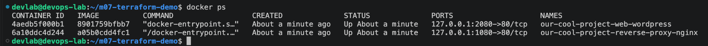

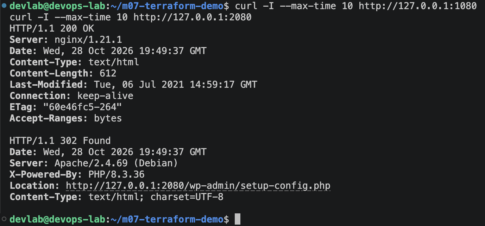

Для проверки через браузер Mac использованы SSH-туннели. Открыты стандартная страница Nginx и страница первичной настройки WordPress.

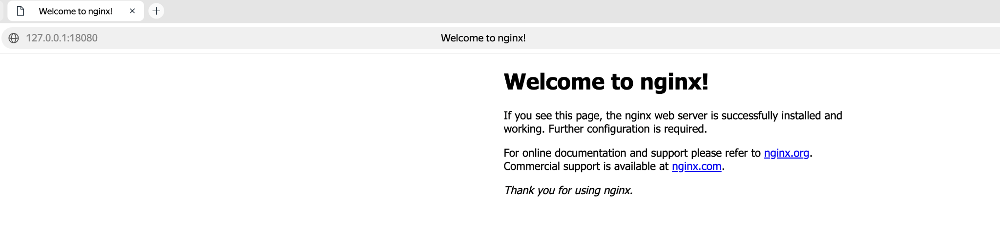

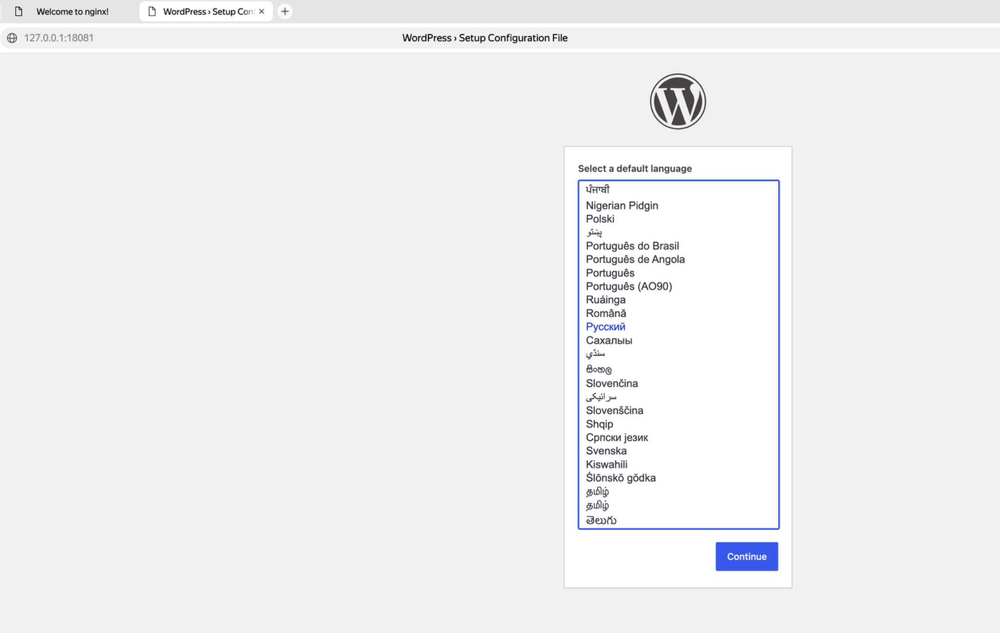

## 4. Terraform Console и дополнительные ресурсы

В `terraform console` проверены значения переменной `var.containers` и её отдельных полей.

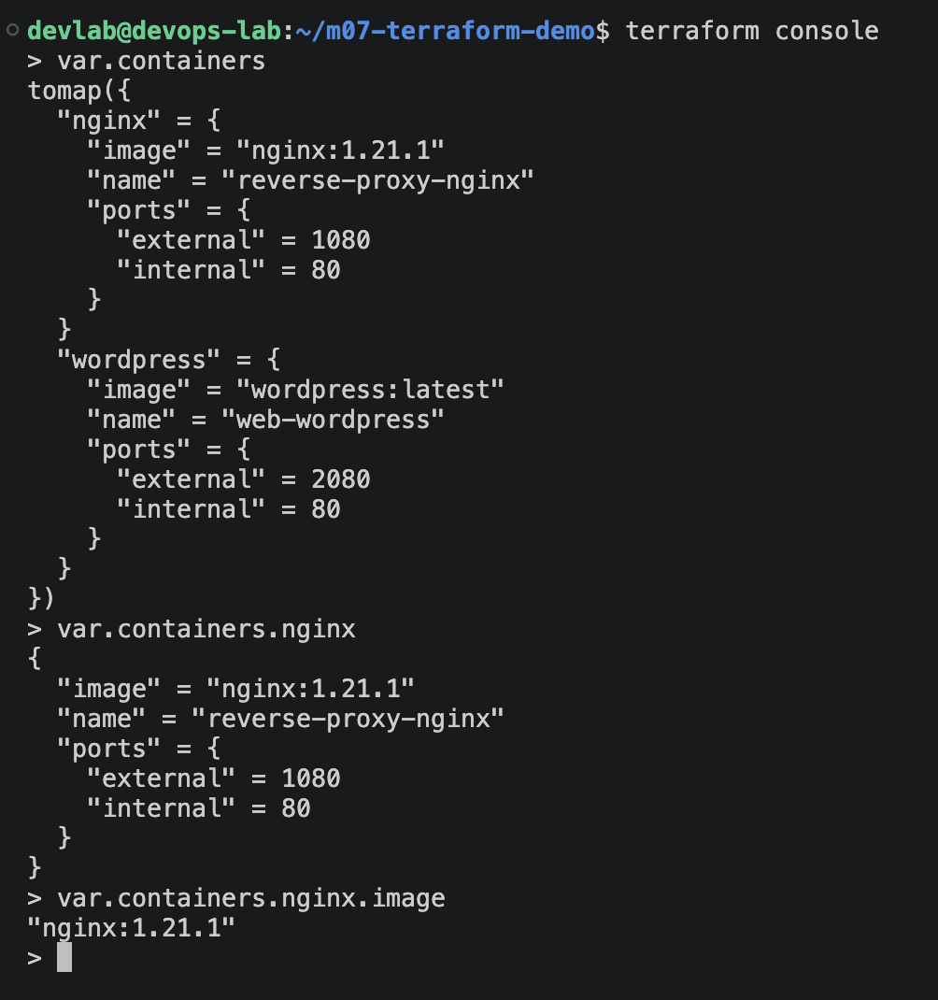

Затем добавлен ресурс `random_password.any_uniq_name` длиной 16 символов. После подключения провайдера `hashicorp/random` выполнен `terraform apply`. Сгенерированное значение не выводилось.

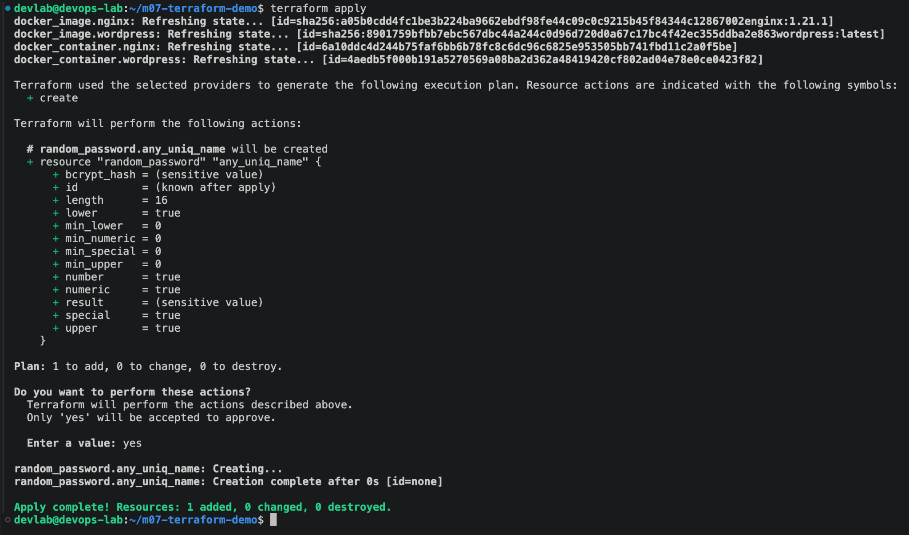

Добавлен ресурс `local_file.xxx`, который записывает строку в `/tmp/xxx.txt`. Для него подключён провайдер `hashicorp/local`. Перед созданием файла права доступа ограничены значением `0600`.

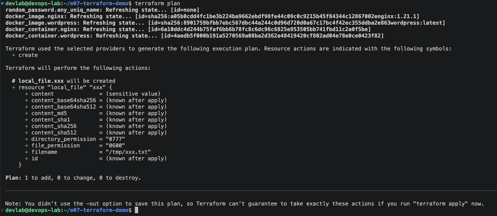

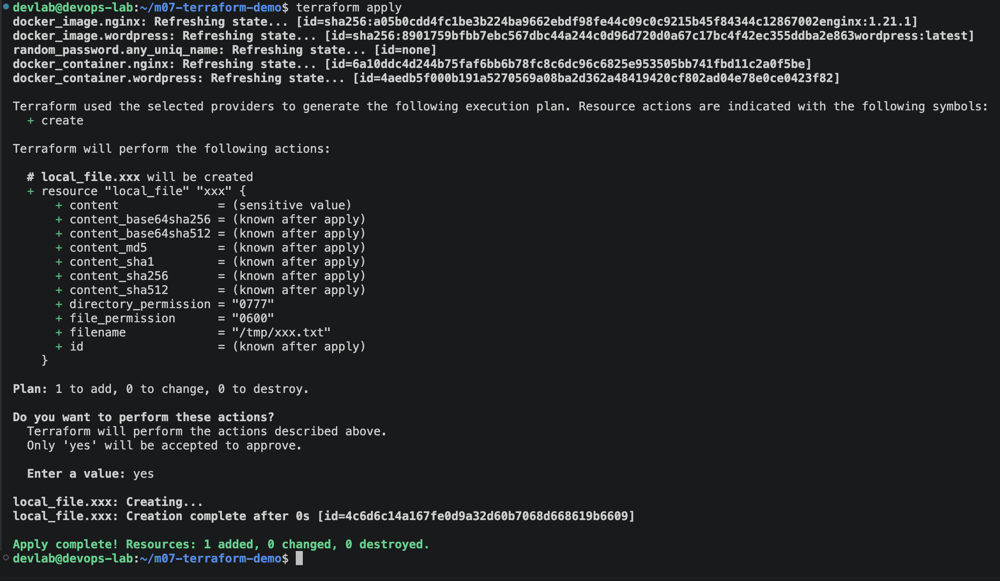

После применения проверены метаданные файла: владелец `devlab`, права `600`, размер 33 байта. Содержимое файла не выводилось.

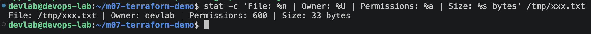

Команда `terraform state list` подтвердила наличие шести управляемых ресурсов: двух образов, двух контейнеров, `random_password` и `local_file`.

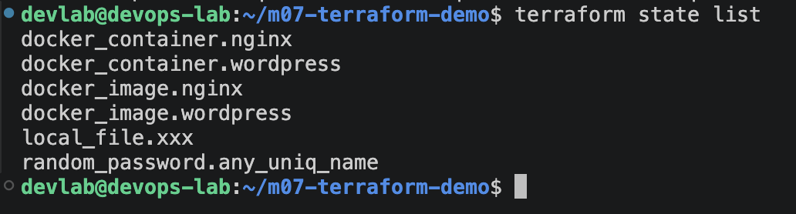

## 5. Проверка изменений вне Terraform

Для проверки реакции Terraform на ручные изменения контейнер Nginx переименован командой:

```bash
docker rename our-cool-project-reverse-proxy-nginx nginx-manually-renamed
```

Контейнер продолжил работать, но фактическое имя перестало совпадать с конфигурацией.

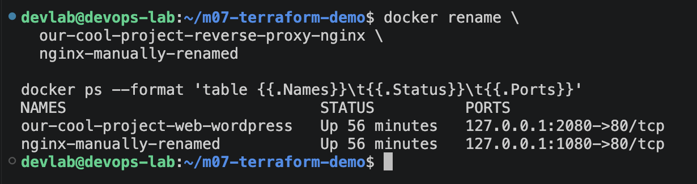

Команда `terraform plan` обнаружила расхождение и предложила пересоздание Nginx:

```text
Plan: 1 to add, 0 to change, 1 to destroy.
```

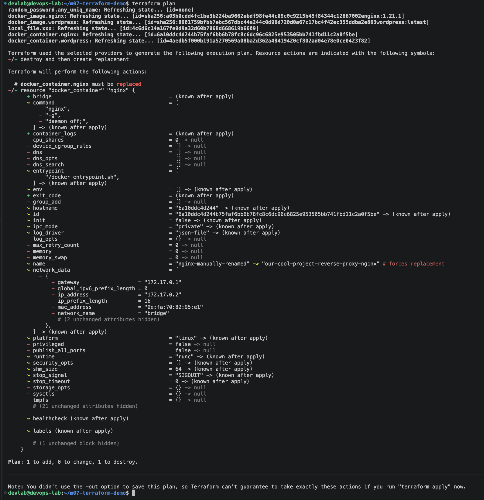

После подтверждения `terraform apply` контейнер пересоздан. Проверка показала восстановленное имя, состояние `running` и ответ HTTP `200`.

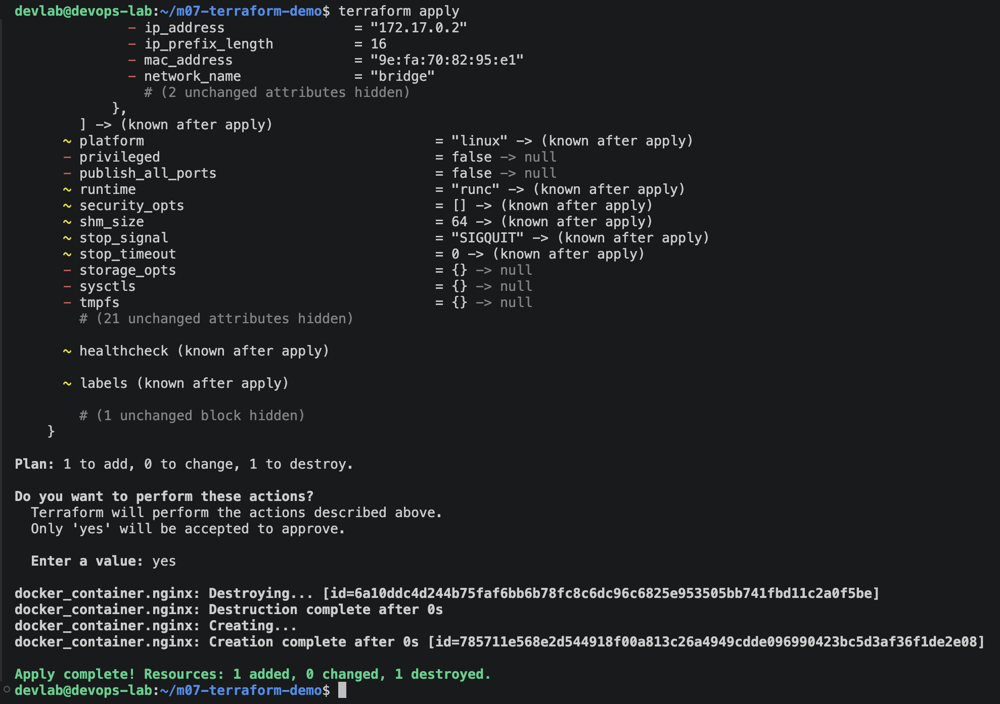

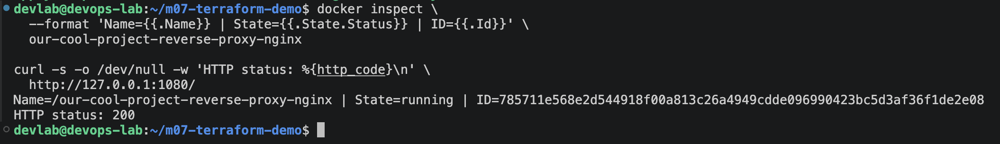

Повторный `terraform plan` подтвердил отсутствие дальнейших изменений:

```text
No changes. Your infrastructure matches the configuration.
```

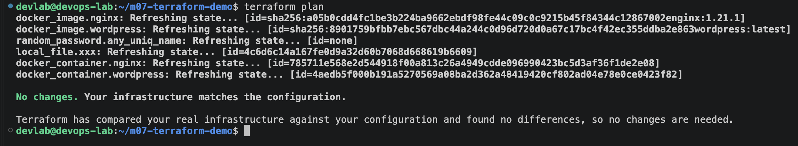

## 6. Итог

Terraform установлен, демонстрация из лекции повторена. Создание контейнеров, работа с переменными и Terraform State, дополнительные ресурсы и восстановление контейнера после ручного изменения проверены на практике.

Файлы Terraform State и каталог `.terraform/` не включаются в репозиторий, так как могут содержать служебные данные и секреты.
